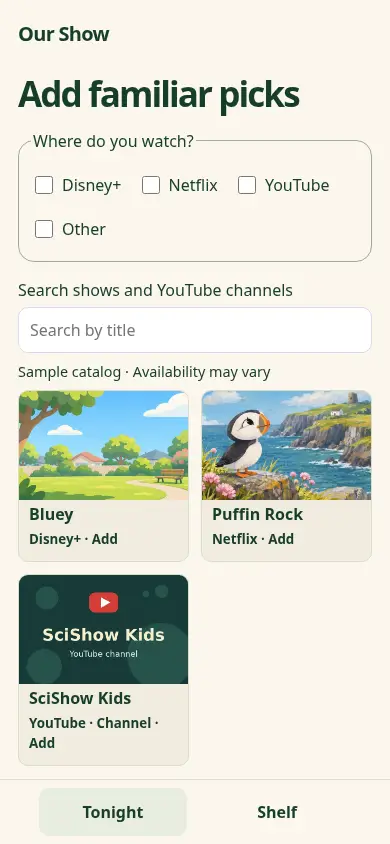
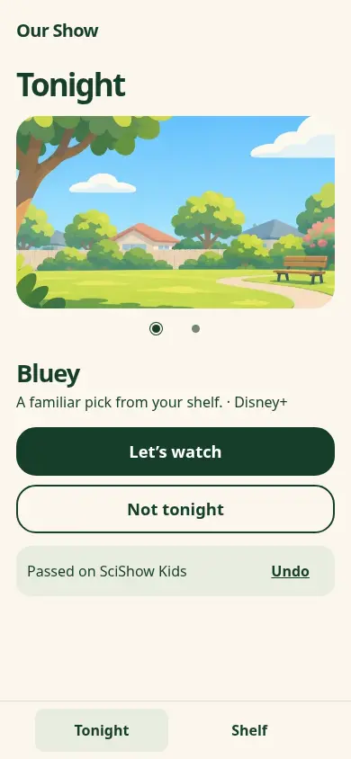
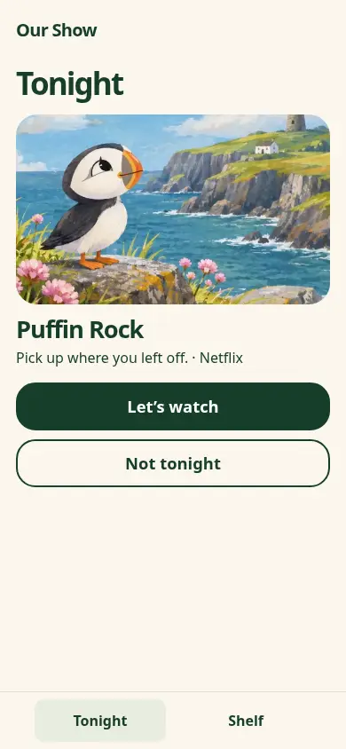
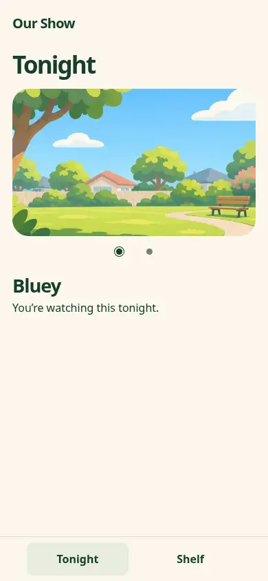

# Tonight couch test

Start with a phone and a fresh browser profile, or with a test copy of the household's shelf.

1. On an empty shelf, choose where you watch. Tap a familiar show from the artwork grid, then search for another title. Try adding SciShow Kids from YouTube. Tap **Go to Tonight** when you have a few options.
2. Start with two different requests from the family. Offer the first Tonight suggestion, then tap **Not tonight** if it doesn't work. See whether the next suggestion reminds anyone of a show they'd forgotten, before the parent offers one. Tap **Undo** to bring back a passed suggestion.
3. On Bluey, swipe the artwork. The active dot should move while the title stays put. A single-image pick has no dots.
4. Tap **Let’s watch**. Reopen the app that evening and confirm the choice is still shown. Open **Shelf** and verify the selection did not change ratings or watch states.
5. With an existing household, open the app and verify it starts on Tonight. Switch profiles on the Shelf and check that shows, ratings, and watch states are still there. Import a legacy backup in a disposable browser profile and check the resulting collections.

## Review captures

| Empty shelf | After a pass | Existing household | Confirmed pick |
| --- | --- | --- | --- |
|  |  |  |  |

Captured at 390 × 844 in Chromium. The browser test verifies the interactions. A family couch test is still needed to learn whether the picks prompt recognition or help resolve disagreement.

Notes for reviewers

- The sample catalog has illustrative provider labels and does not verify regional availability. Bluey and Puffin Rock artwork comes from the [issue mockups](https://github.com/jsmithe/chatgpt-test/issues/19). The SciShow Kids artwork is a sample title card.
- The bundled legacy collection is available via `?demo` in a fresh browser profile. Existing saved collections take precedence.
- Passes and the confirmed pick roll over at 4 a.m. local time and are stored on this browser separately from shelf backups.
- Tonight groups matching shelf entries by title and category because legacy rows have profile-local IDs. It skips shows completed in every profile that has the show and prefers shows with fewer low ratings. A missing rating counts as unknown.

## Reproduce locally

Run `node --test --test-isolation=none` for the Node regressions. For browser coverage, run a local HTTP server and a disposable Chromium instance with remote debugging, then run the script with Node 22 or later.

```sh
python3 -m http.server 8765 --bind 127.0.0.1
chromium --headless --remote-debugging-port=9227 --user-data-dir=/tmp/our-show-review
node scripts/tonight-couch-check.mjs http://127.0.0.1:8765 http://127.0.0.1:9227 docs/tonight
```
